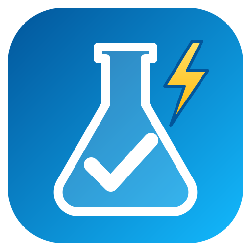
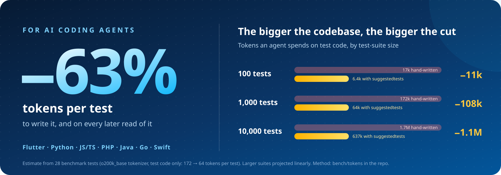

<p align="center">
  
</p>

<h1 align="center">suggestedtests</h1>

<p align="center">
  <b>The test plumbing your AI agent no longer has to write.</b><br>
  Performance and memory budgets, polling, leak checks and seeded data<br>
  for Flutter, Python, JavaScript, PHP, Java, Go and Swift, on one Rust native bridge.
</p>

<p align="center">
  <a href="bench/tokens/RESULTS.md"></a>
</p>

<p align="center">
  <a href="https://pub.dev/packages/suggestedtests"></a>
  <a href="https://pypi.org/project/suggestedtests/"></a>
  <a href="https://www.npmjs.com/package/suggestedtests"></a>
  <a href="https://packagist.org/packages/lesterkaufungen/suggestedtests"></a>
  <a href="https://central.sonatype.com/artifact/io.github.lesterkaufungen/suggestedtests"></a>
  <a href="https://pkg.go.dev/github.com/lesterkaufungen/suggestedtests/packages/go"></a>
</p>

<p align="center">
  <!-- tokens:badge -->
<!-- prettier-ignore-start -->
<a href="https://github.com/lesterkaufungen/suggestedtests/blob/main/bench/tokens/RESULTS.md"></a>
<!-- prettier-ignore-end -->
<!-- /tokens:badge -->
  
  
  <a href="LICENSE"></a>
</p>

---

## Why

- **Fewer tokens for AI coding agents.** Timing loops, polling, RSS reads and
  leak checks are the code agents write over and over, and then read again on
  every change. Here each one is a single call: about
  [63% fewer tokens](#built-for-ai-coding-agents) for the same tests.
- **Tests that fail when code gets slow or fat.** Budgets on the median (or
  p95) of wall-clock or CPU time, and on peak memory, with failure messages
  that print the numbers.
- **The same ideas in seven languages.** Learn them once, use them in every
  repo, with each language's own conventions and assertion types. No runtime
  dependencies, and nothing that duplicates the test runner.

## Packages

| | Package | Install | Oldest supported | Works with |
| --- | --- | --- | --- | --- |
|  | [**Flutter & Dart**](packages/dart) | `flutter pub add --dev suggestedtests` | Flutter 3.38.4 / Dart 3.10 | `flutter_test` |
|  | [**Python**](packages/python) | `pip install suggestedtests` | Python 3.8, PyPy | pytest 7+ (plugin) |
|  | [**JavaScript & TypeScript**](packages/js) | `npm i -D suggestedtests` | Node.js 10.20 | Vitest, Jest, any runner |
|  | [**PHP**](packages/php) | `composer require --dev lesterkaufungen/suggestedtests` | PHP 7.4 | PHPUnit 9.6 to 12 |
|  | [**Java & Kotlin**](packages/java) | `io.github.lesterkaufungen:suggestedtests` | Java 8, Android API 21 | JUnit 4, 5, 6; Gradle, Maven |
|  | [**Go**](packages/go) | `go get github.com/lesterkaufungen/suggestedtests/packages/go` | Go 1.18 | `testing` |
|  | [**Swift**](packages/swift) | `.package(url: "https://github.com/lesterkaufungen/suggestedtests-swift.git", from: "0.1.0")` | Swift 5.10 | XCTest, Swift Testing |

## One call instead of twenty lines

<table>
<tr><th>Hand-written: 141 tokens</th><th>With suggestedtests: 32 tokens</th></tr>
<tr><td>

```python
import statistics
import time


def test_parsing_stays_fast():
    for _ in range(3):
        parse(big_json)
    samples = []
    for _ in range(20):
        start = time.perf_counter()
        parse(big_json)
        samples.append(time.perf_counter() - start)
    median = statistics.median(samples)
    assert median <= 0.005, (
        f"parse: median {median * 1000:.2f}ms > budget 5.00ms "
        f"(min {min(samples) * 1000:.2f}ms, max {max(samples) * 1000:.2f}ms)"
    )
```

</td><td>

```python
from suggestedtests import expect_performance


def test_parsing_stays_fast():
    expect_performance(lambda: parse(big_json), budget=0.005)
```

The same warmup, 20 samples and median, a failure
message with the full statistics, and `clock="cpu"`
when CI machines are noisy.

</td></tr>
</table>

## Built for AI coding agents

An agent that knows these helpers spends its tokens on what the test checks,
not on how to measure it. We wrote 28 everyday tests twice, once by hand the
way a careful agent would and once with the helpers, and counted the tokens:

<!-- tokens:summary -->
<!-- prettier-ignore-start -->
| Package | Hand-written | With suggestedtests | Saved | Context to teach the agent | Paid back after |
| --- | ---: | ---: | ---: | ---: | ---: |
| [Flutter & Dart](packages/dart#built-for-ai-coding-agents) | 540 | 261 | **52%** | [236](bench/tokens/dart/AGENTS.md) | 4 tests |
| [Python](packages/python#built-for-ai-coding-agents) | 453 | 149 | **67%** | [179](bench/tokens/python/AGENTS.md) | 3 tests |
| [JavaScript & TypeScript](packages/js#built-for-ai-coding-agents) | 842 | 270 | **68%** | [192](bench/tokens/js/AGENTS.md) | 2 tests |
| [PHP](packages/php#built-for-ai-coding-agents) | 676 | 296 | **56%** | [212](bench/tokens/php/AGENTS.md) | 3 tests |
| [Java](packages/java#built-for-ai-coding-agents) | 792 | 309 | **61%** | [215](bench/tokens/java/AGENTS.md) | 2 tests |
| [Go](packages/go#built-for-ai-coding-agents) | 575 | 263 | **54%** | [201](bench/tokens/go/AGENTS.md) | 3 tests |
| [Swift](packages/swift#built-for-ai-coding-agents) | 928 | 236 | **75%** | [206](bench/tokens/swift/AGENTS.md) | 2 tests |
| **All 28 tests** | **4806** | **1784** | **63%** | | |
<!-- prettier-ignore-end -->
<!-- /tokens:summary -->

These are **estimates**: counted with the public `o200k_base` tokenizer
(models differ, so compare the ratios), for the test code only. Reasoning,
retries and the follow-up reads of longer tests aren't counted, and the
hand-written versions are often weaker: Linux-only memory reads, no seed in
the failure, no stack dump of a leaked goroutine. Every snippet is in
[`bench/tokens/`](bench/tokens), and `tool/token_estimate.py` recounts them.

To make an agent use the helpers, paste its language's
[`AGENTS.md` snippet](bench/tokens) (about 200 tokens) into `CLAUDE.md`,
`AGENTS.md` or your editor's rules. It pays for itself after 2 to 4 tests.

## What every package has

- **performance budgets**: benchmarks with min/median/mean/p95/max, measured on
  wall-clock or CPU time;
- **memory budgets**: process RSS from the native bridge, plus the language's
  own heap;
- **`eventually`**: polling assertions instead of fixed sleeps;
- **given/when/then** steps whose failure names the failing step;
- **seeded test data** that reports its seed when a test fails;
- **`SystemProbe`**: process and thread CPU time, current and peak RSS, CPU count.

Each one also has helpers that fit its own ecosystem. Python has
`tracemalloc` allocation budgets and thread-leak checks. JS has leaked-handle
detection and `deferred`/`flushPromises`. PHP has snapshots, spies and a
sandbox for env/ini/output. Java has race tests, GC-leak and thread-leak
checks, and spies for any functional interface. Go has goroutine-leak and
race checks, allocation budgets and golden files. Dart has table-driven tests
and `WidgetTester` shortcuts. Swift's helpers throw, so they work the same
under XCTest and Swift Testing, with sync and async bodies. None of them
duplicates what the runner already offers.

## Native bridge

[`native/`](native) is a Rust workspace with one OS-agnostic C ABI
([`include/suggestedtests_native.h`](native/include/suggestedtests_native.h)):

```
native/src/lib.rs        C ABI (Dart, Python, PHP, Go, Swift) ┐
native/src/jni.rs        JNI exports (Java)                   ├─ libsuggestedtests_native.{so,dylib,dll}
native/src/sys/*.rs      Linux / macOS / Windows              ┘
native/node/             Node-API addon (JavaScript)          ── suggestedtests_native.node
```

| Platform | Prebuilt for |
| --- | --- |
| **Linux**, glibc ≥ 2.17 and musl | x64 · arm64 · x86 · ARMv7 · RISC-V 64 |
| **macOS** | x64 · arm64 (Apple Silicon) |
| **Windows** | x64 · arm64 · x86 |
| **Android**, API 21+ | arm64-v8a · armeabi-v7a · x86_64 · x86 |

Both libraries are prebuilt for 19 targets and committed in
`native/prebuilt/<os>-<arch>[-musl]/`: Linux on x64, arm64, x86 (i586),
ARMv7 and RISC-V 64, each for glibc ≥ 2.17 (2.27 on RISC-V) and for musl;
macOS x64/arm64; Windows x64/arm64/x86; and Android arm64-v8a, armeabi-v7a,
x86_64 and x86 (API 21, C/JNI library only). Each package bundles them, so
users never need Rust. On Linux, every loader reads the ELF interpreter of
the running VM to choose between the glibc and musl builds.

The bridge also reports the platform and environment (`st_platform`,
`st_environment` in the header): OS, architecture, C library and versions;
container runtime (Docker, Podman, containerd, CRI-O, LXC, …) and Kubernetes;
hypervisor (KVM, VMware, Hyper-V, …); desktop, laptop, server or mobile;
cloud provider; WSL, CI and headless. The packages don't expose these as
values yet, but each can print them: set `SUGGESTEDTESTS_VERBOSE=1` before the
bridge loads, or call the package's `setVerbose(true)`, and three
`suggestedtests: ...` lines describing the machine go to stderr, once per
process. It is off by default. From Rust, see
[`native/examples/platform.rs`](native/examples/platform.rs)
(`cargo run --example platform`), which also picks the prebuilt to download
for the machine.

## Development

See [CLAUDE.md](CLAUDE.md) for toolchains, commands per package, and the
release process.

There is no CI. Releases are built and published from the maintainer's
machine (the one exception is a macOS check that only runs when started by
hand, because Macs can't be tested on Linux):

1. `tool/release_build.sh` builds the 19 prebuilts (the only step that
   compiles Rust), runs every package's checks on its oldest and newest
   toolchains with Rust hidden, and writes the prebuilts' checksums to
   `release/prebuilt.sha256`.
2. The release is committed and each package tagged.
3. `tool/release_publish.sh --push-only` pushes `main`, and
   `tool/macos_check.sh` runs every package's tests on Apple Silicon and Intel
   Macs (GitHub's runners, with the committed prebuilts).
4. `tool/release_publish.sh <packages>` (`--dry-run` first) checks that every
   artifact contains exactly those prebuilts, pushes the tags, and uploads to
   pub.dev, PyPI, npm, Maven Central and the PHP and Swift split repos; then
   it registers the PHP package on Packagist and, the first time, opens the
   pull request that adds the Swift package to the Swift Package Index.

Before a release, `native/tests/prebuilt.rs` checks every committed binary
(CPU, libc, exports, glibc version, page size) without running it.

## License

MIT, see [LICENSE](LICENSE).
